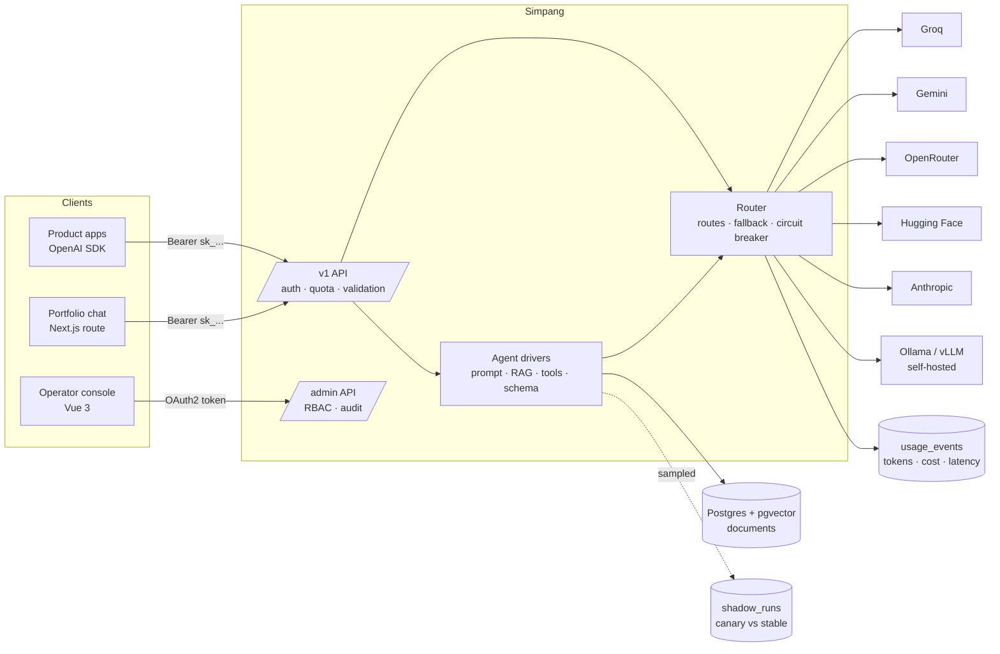

# Simpang

[](https://github.com/seppam/simpang/actions/workflows/ci.yml)

**Simpang** (Indonesian for *junction*) is a small, governed inference gateway: one OpenAI-compatible path from many applications to many model providers, hosted and self-hosted. A request is only allowed under its tenant's policy, the route chosen has to meet the task's quality, latency and cost needs, and a response that succeeds technically but fails the task does not count: so drivers validate their output and every change to a driver is evaluated against a baseline before it ships.

Built solo as a portfolio project in October and November 2026, with Claude Code as a pair programmer (all code reviewed and tested; see the test and eval sections).



## What it does

| Area | What is implemented |
|---|---|
| API | `POST /v1/chat/completions` (OpenAI request/response, SSE streaming with usage chunk), `GET /v1/models`, `POST /v1/drivers/:name/invoke`, `GET /v1/drivers` |
| Providers | Groq, OpenRouter, Hugging Face router, Ollama and vLLM through one OpenAI-compatible adapter; native Gemini and Anthropic adapters (different roles, system prompt, auth header, usage fields and stream events). Native function calling for OpenAI-compatible providers. |
| Routing | `provider/model` or a route `simpang/fast`, `quality`, `cheap`, `local` from a git-versioned catalog (`config/catalog.json`) with list prices; ordered fallback; per-provider circuit breaker; fallback only before the first streamed token |
| Errors | Vendor failures classified (bad_request, not_found, auth, rate_limit, server, timeout, network, aborted): a retired model is a 404, all-rate-limited is 429, all-down is 503, a bad request is not retried elsewhere |
| Tenancy | Per-tenant API keys stored as SHA-256 hashes, uniform 401s, monthly token quotas checked before any provider call, tenant-scoped retrieval |
| Metering | One `usage_events` row per provider attempt: tenant, key, route, attempt number, provider, model, tokens from the vendor (or marked estimated), cost (numeric, from the catalog version recorded with it), latency, status, error kind, driver |
| Drivers | `drivers/<name>/<version>.json` = model + instructions + retrieval + tools + output schema, with `stable`/`canary` channels. `portfolio-qa` v1 (always retrieve, cites `[n]`) and v2 (agentic: the model calls `search_knowledge`), `ticket-triage` v1, v2 and draft v3 with a `recent_changes` tool (JSON validated with JSON Schema, one repair attempt, else 422) |
| RAG | pgvector (HNSW, cosine) in the same Postgres; `nomic-embed-text` via Ollama with task prefixes; chunking keeps the document title in every chunk |
| Evaluation | Datasets, deterministic graders, runner on the production code path, metrics incl. **cost per completed task**, a review file of failures for human error analysis, and a **regression gate** in CI |
| Shadow traffic | A sample of stable driver calls is replayed on the canary in the background; agreement, latency and cost are stored and shown in the console |
| Control plane | OAuth2 client credentials (`/oauth/token`), HS256 tokens (15 min), RBAC (viewer / operator / admin as permission sets), tenant isolation in SQL, audit log; Vue 3 operator console at `/console` |
| Operations | Structured logs with the auth header redacted, Dockerfile (non-root), Helm chart (migration hook, probes, security context, optional HPA/Ingress) verified on kind, Go load-test CLI (TTFT, tokens/s, p95), GitHub Actions (tests, gate, Go, Helm) |

## Evaluation results

Real runs on Groq `openai/gpt-oss-20b` (free tier), 4 November 2026, one run each at temperature 0 (single runs vary by a few points; see Known limits).

**ticket-triage** (30 labelled tickets): v2 adds label definitions and a priority rubric from the support team's labelling guide.

| Metric | v1 | v2 |
|---|---|---|
| Task success (type and priority right) | 10% | **33%** |
| Type accuracy | 60% | 60% |
| Priority accuracy | 27% | **50%** |
| Missing-info F1 | 0.23 | **0.52** |
| Schema-invalid outputs | 0% | 0% |
| Latency p95 | 1745 ms | 3124 ms |
| **Cost per completed task** | $0.000612 | **$0.000195** |

v2 passed the gate and was promoted to stable. Error analysis (`eval/review/`) showed the largest remaining error: tickets caused by a recent system change (`change_impact`) are read as `bug`, because the model never sees the change log. v3 (`drivers/ticket-triage/v3.json`) adds the ticket date and a `recent_changes` tool; it is a **draft, not yet evaluated**: the free-tier daily token quota (200k tokens/day) ran out during its first run, and those results were discarded as invalid rather than scored.

**portfolio-qa** (18 questions incl. 5 that must be declined: salary, phone number, unrelated coding, a false claim, prompt injection): v2 lets the model decide when to search (agentic tool use) instead of always retrieving.

| Metric | v1 (always retrieve) | v2 (agentic) |
|---|---|---|
| Task success | **83%** | 78% |
| Declined when it should | **3 of 5** | 2 of 5 |
| Answers with citations | 61% | 0% |
| Latency p95 | **1584 ms** | 4404 ms |
| Cost per completed task | **$0.000056** | $0.000081 |

The regression gate **blocked v2**: lower success, fewer correct refusals, 2.8x slower and more expensive per task. The more "agentic" design was worse for this task, so v1 stays stable and v2 was withdrawn as canary.

Lessons from running evals for real (also in the commit history): the first run was invalid (a non-UUID tenant id broke retrieval, and a rate-limit burst opened the circuit breaker so every later row failed fast); always read the error codes before the scores. The runner now backs off on per-minute limits, and stops immediately when a provider reports a daily quota (`quota_exhausted`), instead of grinding through retries.

## Run locally

```bash
nvm use                       # Node 24 (runs TypeScript directly, no build step)
npm install
cp .env.example .env          # add GROQ_API_KEY etc. in an editor, never in chat or git
npm run db:up                 # Postgres 17 + pgvector on localhost:5433
npm run migrate
npm run ingest -- portfolio corpus/portfolio     # needs OLLAMA_BASE_URL for semantic vectors
npm run create-key -- my-app                     # prints an API key once
npm run create-client -- platform admin          # prints an OAuth client once (console login)
npm run dev                                      # http://localhost:3000
```

```bash
curl -s localhost:3000/v1/chat/completions -H "Authorization: Bearer $KEY" -H 'Content-Type: application/json' \
  -d '{"model":"simpang/fast","stream":true,"messages":[{"role":"user","content":"halo"}]}'

curl -s localhost:3000/v1/drivers/ticket-triage/invoke -H "Authorization: Bearer $KEY" -H 'Content-Type: application/json' \
  -d '{"input":{"subject":"PPN di invoice salah hitung","description":"Sejak kemarin PPN dobel di semua invoice baru."}}'
```

Self-hosted model: `brew install ollama && ollama serve`, `ollama pull qwen2.5:0.5b nomic-embed-text`, set `OLLAMA_BASE_URL=http://localhost:11434`, then use `ollama/qwen2.5:0.5b` or `simpang/local`.

## Evaluate a driver change

```bash
npm run eval -- ticket-triage          # runs stable and canary on eval/datasets/ticket-triage.jsonl
npm run eval:gate                      # what CI runs: fresh results + canary within tolerance of stable
```

Results go to `eval/results/<driver>@<version>.json` (with the SHA-256 of the driver file and dataset), failures to `eval/review/*.md` for a person to mark "model wrong / label wrong / ambiguous". Changing a prompt without re-running the eval fails CI, because the stored driver hash no longer matches. Promote a canary by editing `drivers/<name>/channels.json` in a reviewed pull request.

## Kubernetes (kind) and load test

```bash
docker build -t simpang:dev .
kind create cluster --name simpang && kind load docker-image simpang:dev --name simpang
helm install simpang deploy/helm/simpang -f deploy/helm/simpang/values-kind.yaml --wait
kubectl port-forward svc/simpang 8080:80
cd bench && go run . -url http://localhost:8080 -model mock/echo -n 200 -c 16
```

See `deploy/README.md` (chart), `deploy/cloud.md` (managed Postgres + Render plan) and `bench/README.md`.

## Tests

`npm test` runs unit tests (fakes for providers, `fetch`, key store, usage sink, retriever) and integration tests against a separate `simpang_test` database (migrations, SQL for keys, quotas, pgvector retrieval with tenant isolation, admin queries). Security cases are tested explicitly: forged and expired JWTs, `alg: none`, wrong-tenant key revocation, viewer writes, keys never in logs or error messages. `bench/` has its own Go tests (`go test -race ./...`).

## Known limits

- Quotas are soft (checked before the call, so concurrent requests can overshoot slightly); a hard quota would reserve tokens.
- If the usage database is down, the request still succeeds and the metering error is logged: a durable outbox would close that gap.
- Native tool calling is implemented for OpenAI-compatible providers; Gemini and Anthropic adapters do not pass tools yet, so the router skips them for tool-using drivers.
- In the cloud without Ollama, embeddings fall back to a lexical hash embedder (see `deploy/cloud.md`).
- Graders are keyword and field based; free-text quality beyond that needs the human review files (an LLM judge is a possible next step).
- Free-tier limits (Groq gpt-oss-20b: 8k tokens/minute, 200k tokens/day) make full evals slow and cap how many runs fit in a day; repeated runs per version (to measure variance) need more quota or more providers.

## Related

- [msp-ops-copilot](https://github.com/seppam/msp-ops-copilot): the application-support triage project whose labelled tickets are the `ticket-triage` dataset.
- Portfolio: https://septian-pamungkas.vercel.app
